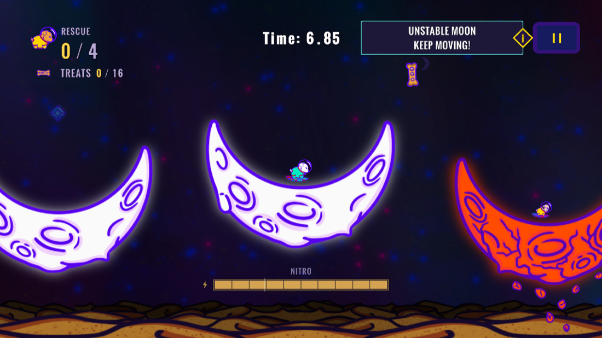
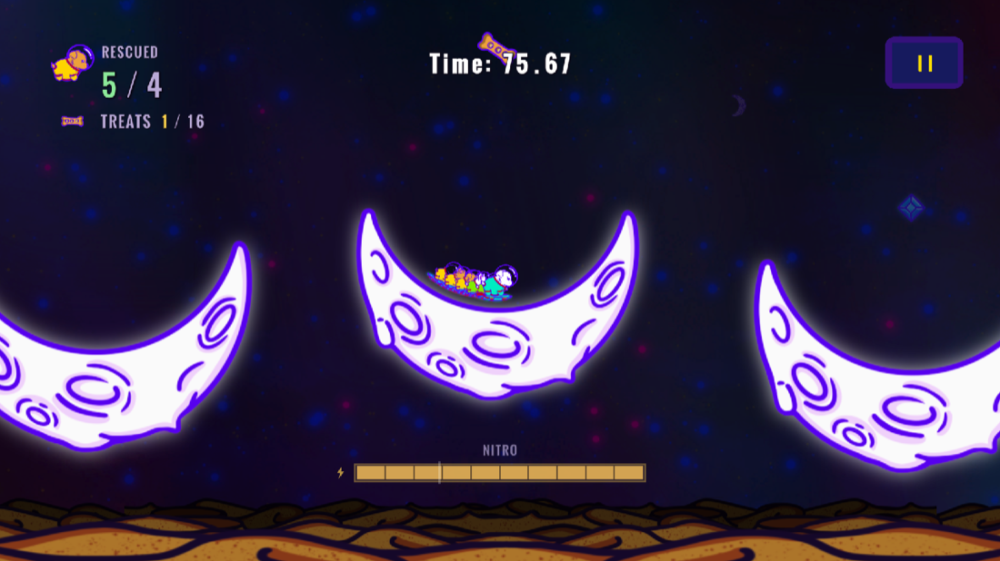

# Jupiter's Crescent

**Skate across Jupiter's crescents. Rescue your friends. Make it home.**

## 🎮 Play Jupiter's Crescent

### **[▶ PLAY NOW ON ITCH.IO](https://bedda-m.itch.io/jupiters-crescent)**

**Free to play · Runs in your browser · Desktop recommended**

---

A 2D momentum platformer about a space dog called Ice, the curved moons he rides,
and the friends he refuses to leave behind.

---

## The Game

Ice is a White Shepherd stranded in orbit around Jupiter. Scattered across a chain
of crescent-shaped moons are the rest of his pack — dogs who went missing when
things went wrong, each one waiting alone on a different moon.

You skate. The crescents are bowls, not platforms, so you drop into the curve,
carry the speed up the far lip, and launch across the gap to the next one. Dogs you
reach fall in behind you and follow in a line. Meteors come down. Some moons
crumble under you, others drift away.

At the far end of the chain there is a ship. You need at least four dogs to board
it. There are seven to find.

---

## Gameplay

**Momentum is the whole game.** There is no run button that saves you. Speed comes
from the shape of the moon you are on — ride the bowl low and you carry enough to
clear the gap. Mistime it and you drop into the dark.

**Nitro** is a finite bar that gates the dash. A dash costs a chunk of it and it
refills slowly, so dashing is a decision rather than a habit. Cells scattered
through the level top it back up.

**The pack follows you physically.** Rescued dogs are joined in a chain of physics
joints, trailing behind through every turn and jump. They are not a number in the
corner — they are bodies you are dragging across a gap, and they can be lost.

**Hazards are telegraphed, not random.** A meteor announces itself with a warning
marker before it lands. Unstable moons give you a moment before they give way.
Drifting moons simply will not be where you left them.

**If you fall, you lose one dog** — not the whole pack. The dropped dog survives
somewhere behind your last checkpoint.

**Press E to whistle.** A dog stranded behind you puts on a board and makes its own
way toward you, skating and jumping between moons under its own power until it
reaches somewhere safe near you. Then it sits down and waits for you to come and
collect it.

**Treats and medals.** Sixteen treats are hidden along the route. Finishing earns a
medal; treats and a full pack earn a better one.

---

## Design & Development

The game started as a flat prototype: one level, three lives, a dog counter in the
corner. It worked, but it played like a test scene. The dogs were a number rather
than characters, the moons were somewhere to stand rather than something to ride,
and falling cost you everything you had collected.

The redesign rebuilt the level around the curve. Most platformers give you flat
ground and ask you to time jumps; this one gives you a concave surface and asks you
to manage momentum on it. That one change made the moons into the main mechanic —
you are reading a shape and deciding when to commit, not waiting for a platform to
line up.

Attaching six other bodies to the player is where it got interesting. A jump you
can clearly make alone is a different jump with five dogs on a joint chain behind
you: the chain stretches as you accelerate, and the last dog is still on the
previous moon when you land on the next. Most of the tuning went into that tension
— how far apart the dogs sit, how far the chain may stretch before it genuinely
breaks, and how a lost friend finds their way back to you.

A few decisions shaped how the level plays:

- **Falling costs one dog, not the pack.** Losing everything to one mistake killed
  the run's momentum and made the back half of the level feel punishing rather than
  tense. One dog is a real loss you can see, and a reason to go back for them.
- **The follower spacing was tightened** after measuring what the chain actually did
  while the game ran, rather than trusting the numbers in the editor. The spacing
  turned out to be sitting at its loosest setting the entire time anyone was moving.
- **Lost dogs come back under their own power.** Teleporting a dog to the player
  would have been simpler, but watching one skate and jump its way across three
  moons to reach you is the moment the pack feels alive.
- **Hazards are introduced one at a time.** The first unstable moon and the first
  drifting moon each appear alone, somewhere a mistake is cheap, before they ever
  show up in combination.

---

## Engineering Highlights

| System | Approach |
| --- | --- |
| Follower chain | `DistanceJoint2D` chain with tuned spacing and a stretch tolerance that tells a jump apart from a stuck dog |
| Autonomous dog recovery | A state machine that skates, picks a jump profile per gap, lands under real physics, and parks |
| Surface alignment | Averaged ground normals drive a visual-only body tilt, with a counter-rotation in the air |
| Character rendering | A sorting group per character, ordered by position in the chain |
| Checkpoint ownership | One component decides where the player and any dropped dogs return to |
| Hazards | Telegraphed meteors, collapsing moons, drifting moons |
| Background | Four parallax depths built from the game's own art |

The level spans 36 crescents, with a route the recovery AI can cross end to end —
every one of its 35 gaps was measured against the real collider geometry and
driven through under physics rather than assumed to work.

---

## Screenshots

*Five rescued dogs following Ice along the inner curve, each leaning with the
surface as they skate.*

---

## Controls

| Input | Action |
| --- | --- |
| `A` / `D` or arrow keys | Skate left and right |
| `Space` | Dash (costs Nitro, needs contact with a crescent) |
| `E` | Whistle — call a stranded dog to make its own way back |
| `R` | Restart the level |
| On-screen button | Pause |

Touch controls appear automatically on mobile browsers, so one build serves both
desktop and phones.

---

## Built With

Unity 6 and C#, using Unity's 2D physics — `Rigidbody2D`, `DistanceJoint2D` and
polygon colliders traced from the crescent artwork. The target platforms are WebGL
and Android.

---

## Project Status

**Released and playable in the browser —
[play it on itch.io](https://bedda-m.itch.io/jupiters-crescent).**

A feature-complete single level with a full loop: skate, rescue, survive the
hazards, reach the ship, earn a medal.

It is a portfolio project rather than a finished commercial game. One level is
playable end to end, and the lives system is implemented but currently switched off
while the fall penalty is being balanced.
